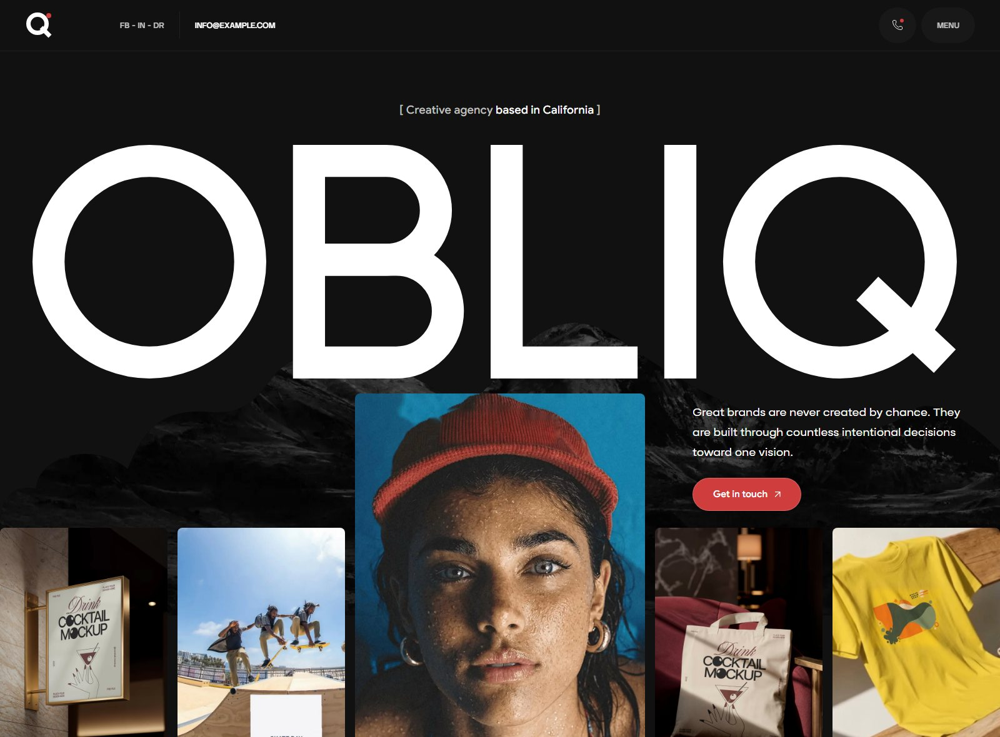

# Obliq Agency - Frontend

**Live site:** https://mirnabahaa.github.io/Obliq-agency/



## 1. Description

A responsive, multi-page website for **Obliq**, a creative agency, built with Next.js and animated with GSAP ScrollTrigger. Pages: home, about, service, works (with category filter), 10 work details, blog, 12 blog posts, pricing (monthly/yearly), contact, changelog, licenses, style guide, 404, and password. It respects `prefers-reduced-motion`.

> **Note:** Projects, testimonials, statistics, blog posts, and contact details on the site are placeholders. Most media loads from a remote CDN.

## 2. Languages, Runtime, and Packages

- **Languages:** JavaScript (JSX), CSS with custom properties
- **Runtime:** Node.js 20.9+ with npm
- **Packages:** `next` ^16.4.6, `react` ^19.3.1, `react-dom` ^19.3.1, `gsap` ^3.15.1

## 3. Project Setup

```bash
git clone https://github.com/MirnaBahaa/Obliq-agency.git
cd Obliq-agency
npm ci
npm run dev       # http://localhost:3000
npm run build     # production build
npm run start     # serve the build
npm run build:pages  # static export for GitHub Pages, written to out/
```

No environment variables are needed. Every push to `main` rebuilds the site and publishes it to GitHub Pages (`.github/workflows/deploy-pages.yml`).

## 4. Project Structure

| Path          | Contents                                                        |
| ------------- | --------------------------------------------------------------- |
| `app/(home)/` | Homepage route and its stylesheet (`theme.css`)                 |
| `app/(site)/` | All other routes, including `work/[slug]` and `post/[slug]`, with the full stylesheet (`site.css`) |
| `components/` | Homepage sections, navbar, footer, logo, icons, and shared UI   |
| `components/pages/` | Content for each inner page, plus the work and post templates |
| `lib/`        | Animations and interactions (`motion.js`, `interactions.js`), brand details, media URLs, and the work and post data (`works.js`, `posts.js`) |
| `public/images/` | Locally hosted images                                        |
| `docs/`       | README screenshot                                               |

## 5. Project Details

| Field            | Value                                                                                   |
| ---------------- | --------------------------------------------------------------------------------------- |
| Project          | Obliq Agency - creative-agency website (frontend)                                       |
| Owner / Designer | Mirna                                                                                   |
| Repository       | [github.com/MirnaBahaa/Obliq-agency](https://github.com/MirnaBahaa/Obliq-agency)        |
| Type             | Marketing website for a creative agency based in California                             |
| Scope            | 13 page designs and 37 routes: home, about, service, works, work details, blog, blog posts, pricing, contact, changelog, licenses, style guide, 404, password |
| Layouts          | Desktop (≥992px), tablet (768–991px), phone landscape (480–767px), phone portrait (≤479px) |
| Brand            | Obliq: original logo mark and wordmark; near-black `#111111`, red `#CF3D3D`, peach `#FFA589`, white `#FFFFFF` |
| Typography       | Stack Sans Headline (headings), Goli (body), Google Sans (labels, menu, and form text)  |
| Accessibility    | Keyboard-reachable menu and controls, ARIA labels, alt text, video pause controls, reduced-motion support |
| Started          | November 2026                                                                           |

### Remaining work

- Replace placeholder content and CDN-hosted media with Obliq's own.
- Retouch or replace the photos that still show the old brand name on the product (packaging, cans, book cover, jacket).
- Connect the contact form, newsletter, and password page to a real backend; they only show their on-screen states now.

## Project Status

| Field    | Value       |
| -------- | ----------- |
| Designer | Mirna       |
| Tool     | Claude Code |
